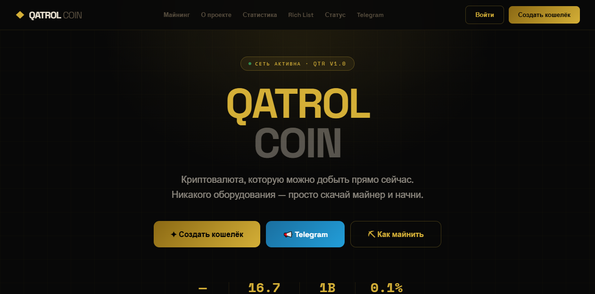
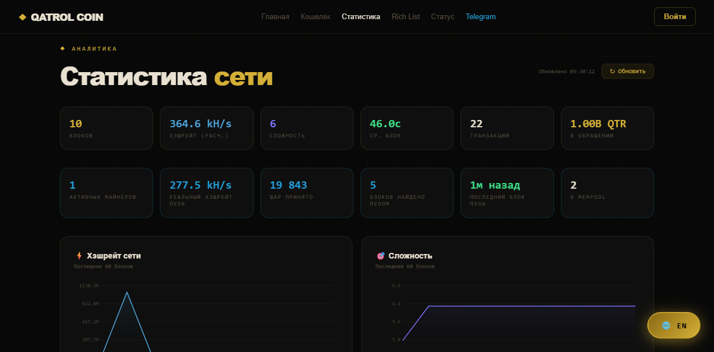
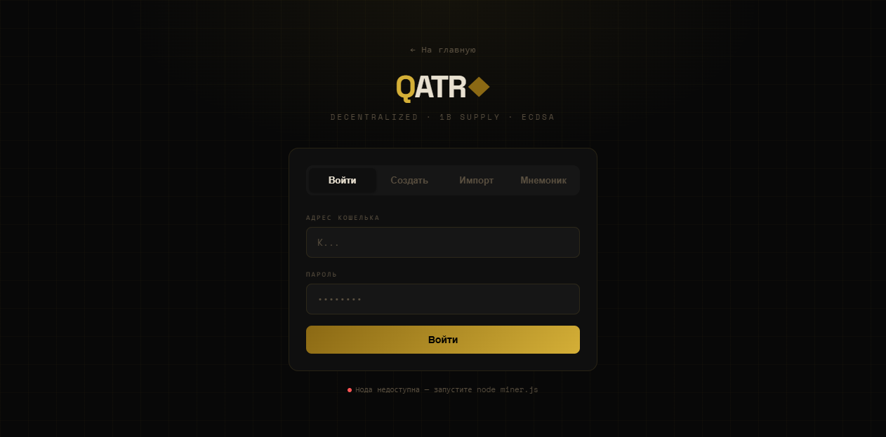

# Qatrol Coin (QTR)

Своя криптовалюта на чистом Node.js: нода с цепочкой блоков, майнер с proof-of-work, пул для чужих майнеров, веб-интерфейс с кошельком и Telegram-бот.

Снимок с домашнего ПК от 22.11.2026. В этом проходе проект развёрнут, проверен тестами и починен: было три бага, включая чтение любого файла с диска через веб-сервер.







Ещё скриншоты: [статус ноды](screenshots/status.png), [rich list](screenshots/richlist.png). Сняты с запущенной ноды, на странице статистики видно 10 блоков и реальный хэшрейт.

## Что внутри

Один репозиторий, четыре процесса, все общаются по HTTP на localhost.

| Процесс | Порт | Файл | Что делает |
|---|---|---|---|
| Нода + майнер | 3001 | `miner.js` | цепочка, мемпул, кошельки, API, P2P, добыча блоков |
| Веб | 3000 | `server.js` | статика из `public/` и прокси `/api` → нода, `/pool` → пул |
| Пул | 3002 | `pool/server.js` | выдаёт задания, собирает шары, отправляет блоки в ноду |
| Бот | — | `bot/index.js` | Telegram: баланс, блоки, транзакции, статистика |

Ещё есть TUI-дашборд (`tui/dashboard.js`) для экрана без графики и клиент пула (`pool/miner-client.js`), который собирается в exe.

## Быстрый старт

Нужен Node.js 18 или новее. Никаких npm-пакетов для ноды и веба не требуется, вся криптография на встроенном `crypto`.

```bash
npm install            # нужен только для бота (node-telegram-bot-api)
node miner.js          # терминал 1: первый запуск спросит кошелёк
node server.js         # терминал 2: открой http://localhost:3000
```

При первом старте нода спрашивает, что делать: создать кошелёк, ввести адрес, ввести приватный ключ или восстановить из мнемоника. Первый кошелёк получает genesis-баланс всей эмиссии.

Без интерактива (сервер, systemd, pm2):

```bash
QTR_MINER_ADDRESS=K...  node miner.js      # только добыча на адрес
QTR_MINER_PRIVATE_KEY=... node miner.js    # полный кошелёк с ключом
QTR_NO_MINE=true node miner.js             # чистая нода без майнинга
```

## Параметры сети

| Параметр | Значение |
|---|---|
| Тикер | QTR |
| Эмиссия | 1 000 000 000 QTR, фиксированная |
| Награда за блок | 16.7 QTR |
| Хэш | SHA-256 от `{index, prevHash, timestamp, transactions, nonce, difficulty}` |
| Сложность | авто, от 5 до 14, не ниже 6, пересчёт по среднему времени блока |
| Комиссия | 0.1% от суммы, минимум 0.0001 QTR |
| Блок | все транзакции из мемпула, награда идёт отдельной REWARD-транзакцией |
| Комиссия пула | 2% от награды блока |

Сложность считается от последних блоков: слишком быстро нашли, растёт, слишком медленно, падает. Без явной фиксации (`FIXED_DIFFICULTY` в `blockchain.js`) она подстраивается сама.

## Кошельки и авторизация

Ключи: ECDSA P-256 из встроенного `crypto`. Адрес это `K` плюс первые 39 символов SHA-256 от публичного ключа в DER, всего 40 знаков. Старые адреса, включая genesis, длиннее на один символ, валидация принимает оба формата.

Приватный ключ хранится на диске зашифрованным: AES-256-GCM, ключ шифрования выводится из пароля через PBKDF2-SHA256 со 100 000 итераций и солью 16 байт. Без пароля ключ не достать, поэтому пароль восстановлению не подлежит.

Сессии живут 7 дней, токен 32 случайных байта в hex. Хранится в `sessions.json`, передаётся заголовком `X-Session-Token` или cookie `koin_session`. Один кошелёк держит одну активную сессию: новый вход гасит предыдущий.

## API ноды

Все методы, кроме `/stats`, `/chain`, `/mempool`, `/peers`, `/richlist` и `/chartdata`, требуют заголовок с токеном.

| Метод | Путь | Назначение |
|---|---|---|
| GET | `/stats` | блоки, сложность, хэшрейт, эмиссия, пиры |
| GET | `/chain` | цепочка целиком |
| GET | `/chain/p2p` | цепочка для синхронизации с пирами |
| POST | `/block/push` | принять блок от пира |
| GET | `/mempool` | неподтверждённые транзакции |
| GET | `/richlist` | адреса по балансу |
| GET | `/chartdata` | точки для графиков |
| GET | `/peers` | список пиров |
| POST | `/peers/add` | добавить пира по url |
| POST | `/auth/register` | новый кошелёк, возвращает ключ и мнемоник |
| POST | `/auth/login` | вход по адресу и паролю |
| POST | `/auth/import` | импорт по приватному ключу |
| POST | `/auth/restore` | восстановление из мнемоника |
| GET | `/auth/me` | данные кошелька по сессии |
| POST | `/auth/mnemonic` | показать мнемоник после проверки пароля |
| POST | `/send` | перевод, нужен пароль для подписи |
| GET | `/pool/template` | задание для пула |
| POST | `/pool/submit-block` | блок от пула |
| POST | `/pool/add-tx` | транзакция от пула |

Веб-сервер повторяет всё это под префиксом `/api`, например `GET /api/stats` проксируется в `GET /stats` ноды. На API ноды стоит лимит запросов на IP, на тело запроса 1 МБ.

## Пул

`pool/server.js` держит задания на текущий блок и считает шары. Майнер скачивает клиент (`pool/miner-client.js`), который собирается в один exe:

```bash
npm run build:miner-win:embed      # Windows, с зашитым адресом пула
node pool/miner-client.js K... host:3002
```

Сложность шары 3, реальная сложность приходит от ноды. Нашёл шару, получил долю от 16.7 QTR пропорционально шарам, минус 2% пула. Блоки пул отправляет в ноду сам через `/pool/submit-block`, ключ пула лежит в `QTR_POOL_PRIVATE_KEY`.

## Переменные окружения

```bash
QTR_PORT=3001              # API ноды
QTR_WEB_PORT=3000          # веб
QTR_POOL_PORT=3002         # пул
QTR_API_HOST=127.0.0.1     # адрес ноды для веба
QTR_PUBLIC_HOST=           # внешний адрес, попадает в список пиров
QTR_NO_MINE=true           # нода без майнинга
QTR_MINER_ADDRESS=K...     # адрес для награды
QTR_MINER_PRIVATE_KEY=...  # приватный ключ для полного кошелька
QTR_MINER_MNEMONIC="..."   # или мнемоник из 12 слов
QTR_POOL_ADDRESS=K...      # адрес для наград пула
QTR_POOL_API_KEY=...       # ключ для /pool/submit-block
QTR_POOL_PRIVATE_KEY=...   # ключ кошелька пула для выплат
QTR_BOT_TOKEN=...          # токен Telegram-бота
```

`.env` рядом с кодом читает сам `miner.js`, отдельный пакет не нужен.

## Деплой на VPS

```bash
npm install -g pm2
pm2 start ecosystem.config.js
pm2 save && pm2 startup
```

Nginx перед нодой: статика на 3000, `/api/` на 3001, `/pool/` на 3002, TLS через certbot. Нода и пул слушают localhost, наружу торчит только nginx.

## Тесты

```bash
node test-api.js
```

Скрипт поднимает запросы к запущенным ноде и вебу и проверяет 30 вещей: отдачу страниц, `/stats`, `/chain`, `/mempool`, `/richlist`, весь цикл кошелька (регистрация, вход, неверный пароль), отказ отправки без авторизации, отрицательные суммы, битый адрес, пустой кошелёк, защиту от обхода каталогов и задание пула. Последний прогон: 30 из 30.

Проверено вживую: нода смайнила 10 блоков, сложность сама выросла с 5 до 7, хэшрейт 650 кH/s, цепочка после перезапуска прошла валидацию, страницы показывают эти цифры.

## Что починено в этом проходе

1. **Обход каталога в веб-сервере.** `server.js` склеивал путь как `path.join(__dirname, 'public', url)`, поэтому `GET /../package.json` отдавал файл из корня проекта, а с большим числом `../` можно было читать что угодно с диска. Теперь путь декодируется, отбрасывается при наличии `..` или нулевого байта и проверяется, что результат остался внутри `public/`.
2. **Отправка на несуществующий адрес.** `/send` проверял только что поле не пустое, монеты можно было сжечь опечаткой. Добавлена проверка формата адреса с поддержкой обоих размеров.
3. **Файлы данных зависели от текущего каталога.** `blockchain.json`, `wallets.json`, `sessions.json` и `peers.json` открывались по относительному пути, поэтому запуск `node /opt/qatrol/miner.js` из другого каталога создавал пустые данные рядом с этим каталогом. Теперь все пути собираются от `__dirname`.
4. **Сессии читались с диска на каждом запросе.** Теперь кеш в памяти, файл перечитывается только когда изменила другая вкладка по mtime.
5. **Не было лимита на тело запроса.** POST с огромным JSON ронял ноду по памяти. Теперь всё, что больше 1 МБ, отбивается с кодом 413.
6. **Мелочи в сборке.** `pkg` переехал в devDependencies, `dotenv` в pm2-конфиге стал необязательным, путь к `.env` больше не прописан жёстко как `/root/.env`, подключён `npm test`.

## Что не доделано

- `index.js` и `index_current.js` в корне это старые версии ноды, рабочая точка входа это `miner.js`. Файлы оставлены как история, при чистовой уборке их можно удалить.
- Нода не проверяет подпись транзакции на чужом блоке от P2P так же строго, как свою. Для чужой сети это даст дырку, для тестовой хватает.
- Нет ограничения на количество аккаунтов с одного IP: проверка пароля есть, но перебор между разными кошельками не тормозится.
- Адреса двух форматов (40 и 41 символ) остаются. Переход на один сломал бы старые кошельки, поэтому валидация просто принимает оба.

## Структура

```
miner.js               нода, майнер, HTTP API, сессии
blockchain.js          блоки, PoW, балансы, комиссии, валидация цепочки
auth.js                кошельки (AES-256-GCM), сессии, мнемоник
crypto/ecdsa.js        подписи P-256, адреса
crypto/mnemonic.js     BIP-39 мнемоник
p2p/node.js            пиры, синхронизация цепочки
pool/server.js         пул, задания, шары
pool/miner-client.js   клиент пула, собирается в exe
server.js              веб-сервер и прокси
public/                лендинг, кошелёк, статистика, статус, rich list
tui/dashboard.js       TUI для терминала
bot/index.js           Telegram-бот
scripts/               сборка exe с зашитым пулом
test-api.js            тесты API
```
