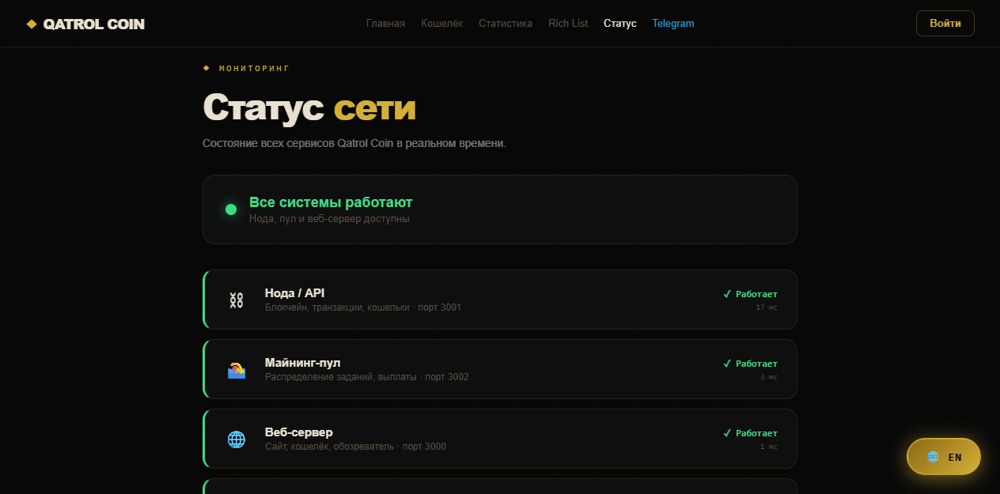
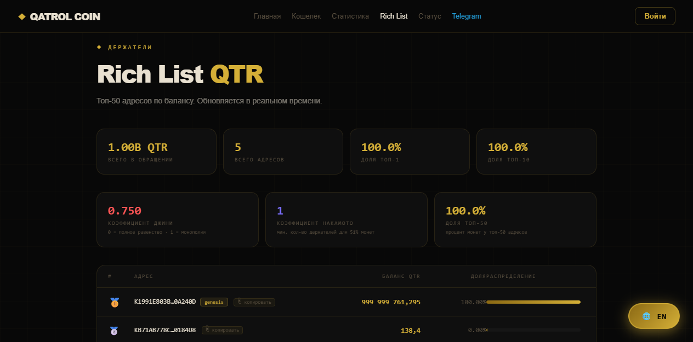
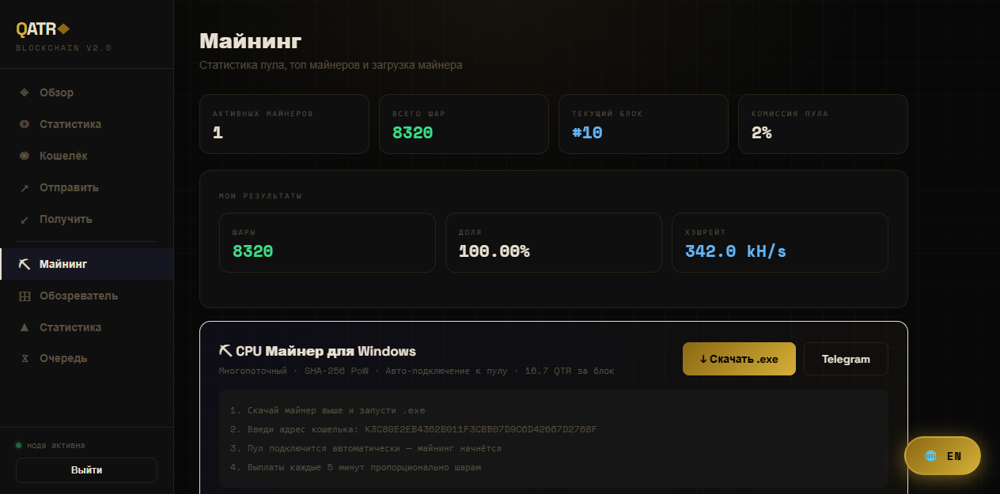
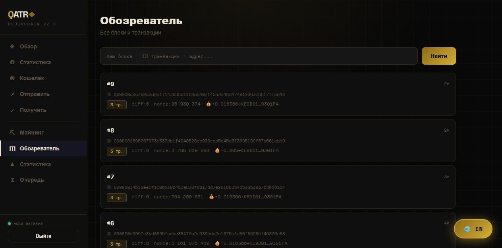

# Qatrol Coin (QTR)

[](https://github.com/Qatrol/qatrol-node/actions/workflows/ci.yml)
[](LICENSE)
[](package.json)
[](https://github.com/Qatrol/qatrol-node/releases)

Своя криптовалюта на чистом Node.js: нода с proof-of-work, пул для чужих майнеров, веб-кошелёк с обозревателем и Telegram-бот. Ноде и вебу хватает встроенного `crypto`, внешние пакеты им не нужны.


## Что внутри

Четыре процесса, общение по HTTP на localhost.

| Процесс | Порт | Файл | Что делает |
|---|---|---|---|
| Нода + майнер | 3001 | `miner.js` | цепь, мемпул, кошельки, API, P2P, добыча блоков |
| Веб | 3000 | `server.js` | статика из `public/`, прокси `/api` → нода, `/pool` → пул |
| Пул | 3002 | `pool/server.js` | задания воркерам, шары, отправка блоков, выплаты |
| Бот | — | `bot/index.js` | Telegram: баланс, блоки, переводы, статистика |

Ещё есть TUI-дашборд (`tui/dashboard.js`) и клиент пула (`pool/miner-client.js`), который собирается в один exe.

## Быстрый старт

Нужен Node.js 18 или новее. Пакеты для ноды и веба не нужны.

```bash
git clone https://github.com/Qatrol/qatrol-node.git
cd qatrol-node
node miner.js     # терминал 1: первый запуск спросит кошелёк
node server.js    # терминал 2: http://localhost:3000
node pool/server.js
```

При первом запуске нода предлагает создать кошелёк, ввести адрес, ввести приватный ключ или восстановить из мнемоника. Первый кошелёк получает genesis-баланс всей эмиссии.

Без интерактива (сервер, systemd, pm2):

```bash
QTR_MINER_ADDRESS=K...    node miner.js   # только добыча на адрес
QTR_MINER_PRIVATE_KEY=... node miner.js   # полный кошелёк с ключом
QTR_NO_MINE=true          node miner.js   # чистая нода без майнинга
```

Переменные перечислены в [node.env.example](node.env.example). `.env` рядом с кодом читают и нода, и пул.

## Параметры сети

| Параметр | Значение |
|---|---|
| Тикер | QTR |
| Эмиссия | 1 000 000 000 QTR, фиксированная |
| Награда за блок | 16.7 QTR из genesis-кошелька |
| Хэш | SHA-256 от `{index, prevHash, timestamp, transactions, nonce, difficulty}` |
| Сложность | авто, от 6 до 14, пересчёт по среднему времени блока, шаг не больше 2 |
| Целевое время блока | 10 минут, снижение до 3 пунктов, если сеть встала дольше 5 минут |
| Комиссия | 0.1% от суммы, минимум 0.0001 QTR |
| Комиссия пула | 2% от награды |
| Блок | все валидные транзакции мемпула + REWARD + SYSTEM_FEE |

Genesis-кошелёк определяется по самой цепи (`chain[0]`). `genesis.json` создаётся при инициализации и чинится, если разошёлся. Награда за блок платится переводом с genesis на адрес майнера, эмиссия не растёт.

## Кошельки и авторизация

Ключи — ECDSA P-256 из встроенного `crypto`. Адрес это `K` плюс 39 hex-символов SHA-256 от публичного ключа в DER, всего 40 знаков. Старые 41-символьные адреса тоже принимаются.

Приватный ключ лежит на диске зашифрованным: AES-256-GCM, ключ из пароля через PBKDF2-SHA256 (100 000 итераций, соль 16 байт). Без пароля ключ не достать.

Сессия — 32 случайных байта, живёт 7 дней. Cookie `koin_session` ставит сервер с `HttpOnly`, плюс токен можно передавать заголовком `X-Session-Token`. Один кошелёк держит одну активную сессию.

## Майнинг и пул

Пул раздаёт задания и принимает шары сложности 3. Нашёл шару полной сложности — пул отправляет блок в ноду и делит награду между активными воркерами пропорционально шарам минус 2%. Выплаты ставятся в мемпул и подтверждаются следующим блоком.

```bash
node pool/miner-client.js K... 127.0.0.1:3002   # воркер, N потоков
QTR_THREADS=4 node pool/miner-client.js ...      # ограничить число потоков
npm run build:miner-win:embed                    # exe с зашитым адресом пула
```

Шары не считаются дважды: пара `jobId:nonce` принимается один раз. Шары сбрасываются только тем, кому реально ушла выплата.

## API ноды

Публичные методы: `/stats`, `/chain`, `/mempool`, `/peers`, `/richlist`, `/chartdata`. Остальное требует сессию.

| Метод | Путь | Назначение |
|---|---|---|
| GET | `/stats` | блоки, сложность, хэшрейт, эмиссия, пиры |
| GET | `/chain` | цепочка постранично |
| GET | `/chain/p2p` | цепочка целиком для синхронизации |
| POST | `/block/push` | принять блок от пира |
| GET | `/mempool` | неподтверждённые транзакции |
| GET | `/richlist` | адреса по балансу |
| GET | `/chartdata` | точки для графиков |
| POST | `/auth/register` | новый кошелёк: адрес, ключ, мнемоник |
| POST | `/auth/login` | вход по адресу и паролю |
| POST | `/auth/import` | импорт по приватному ключу |
| POST | `/auth/restore` | восстановление из мнемоника |
| GET | `/auth/me` | кошелёк по сессии |
| POST | `/send` | перевод, нужен пароль для подписи |
| GET | `/pool/template` | задание для пула |
| POST | `/pool/submit-block` | блок от пула |
| POST | `/pool/add-tx` | транзакция от пула |

Веб повторяет это под префиксом `/api`. На ноде лимит запросов на IP и тело до 1 МБ. Нода и пул по умолчанию слушают только `127.0.0.1`, наружу отдаётся веб. Для прямого доступа к P2P есть `QTR_BIND=0.0.0.0`.

## P2P

Раз в 10 секунд нода сверяет высоту цепи с пирами. Чужая цепь принимается, только если совпадает genesis-хэш, проходят структура, PoW, сложность и каждая транзакция; балансы пересчитываются с нуля. Начальные адреса задаются через `QTR_BOOTSTRAP_PEERS`. Приватные и loopback-адреса в пиры не добавляются.

## Деплой

```bash
npm install -g pm2
pm2 start ecosystem.config.js
pm2 save && pm2 startup
```

Nginx ставится перед нодой: статика на 3000, `/api/` на 3001, `/pool/` на 3002, TLS через certbot. Порты ноды и пула наружу не открывать.

## Тесты

```bash
node test-api.js
```

30 проверок: страницы, публичный API, регистрация и вход, неверный пароль, отказ перевода без авторизации и из пустого кошелька, обход каталогов, задание пула. То же гоняется в GitHub Actions на Node 18, 20 и 22.

Живая проверка 1.1.0: нода намайнила цепочку, пул нашёл блоки и выплатил воркеру 16.366 QTR, перевод из веб-кошелька прошёл от подписи до подтверждения, после перезапуска цепь и балансы на месте.

## Безопасность

Что закрыто в 1.1.0:

- минтинг через `SYSTEM`/`REWARD` в `/pool/add-tx` и P2P-мемпул: системные транзакции принимаются только из локального сборщика блока;
- блоки от пира и пула проверяются по транзакциям: подписи, балансы, суммы награды и комиссий, переиспользование nonce;
- чужая цепь принимается только при совпадении genesis и проходит полную валидацию;
- пул-эндпоинты без ключа пускают только localhost, для внешних ключ обязателен;
- повтор шар и повтор подписи с новым `id` не оплачиваются;
- всё, что приходит из сети, экранируется в обозревателе и кошельке; `memo` ограничен 200 символами;
- cookie сессии `HttpOnly`, библиотеки QR и графиков лежат локально;
- лимиты тела и таймауты на веб-прокси и пуле, rate limit на вход, регистрацию и переводы.

Как сообщить об уязвимости: [SECURITY.md](SECURITY.md).

## Известные ограничения

- Это учебная сеть, а не биржа. Аудита, холодного хранения и защиты от 51%-атаки нет.
- Мнемоник свой, не BIP-39: совместимости с внешними кошельками нет.
- В подписи транзакции нет `memo`, поэтому заметку можно подменить при релее. Replay закрыт проверкой nonce.
- Telegram-бот не покрыт тестами: без токена его не проверить в CI.

## Скриншоты

| | |
|---|---|
|  |  |
|  |  |
|  |  |

Ещё: [очередь транзакций](screenshots/queue.png).

## Структура

```
miner.js               нода, майнер, HTTP API
blockchain.js          блоки, PoW, балансы, комиссии, валидация
auth.js                кошельки (AES-256-GCM), сессии, мнемоник
crypto/                ECDSA P-256, адреса, мнемоник
lib/storage.js         атомарная запись JSON
p2p/node.js            пиры, синхронизация
pool/server.js         пул, задания, шары, выплаты
pool/miner-client.js   клиент пула
server.js              веб-сервер и прокси
public/                лендинг, кошелёк, статистика, статус, rich list
tui/dashboard.js       TUI для терминала
bot/index.js           Telegram-бот
docs/ARCHITECTURE.md   как всё устроено
test-api.js            тесты API
```

## Лицензия

MIT. Только не называй это инвестицией.
